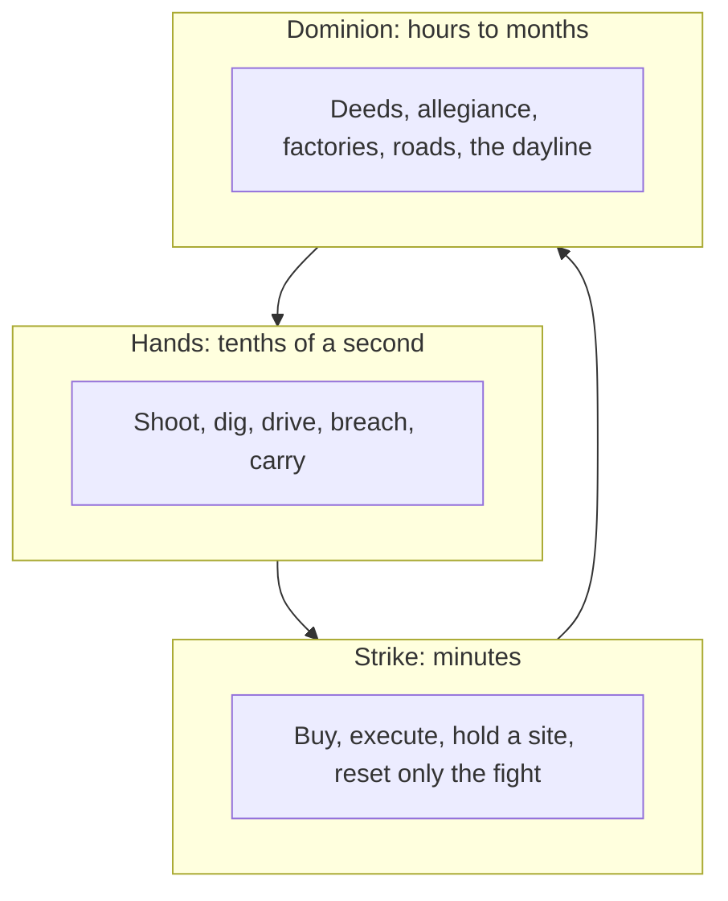

# MERIDIAN
### High-level concept
**A peer-to-peer, browser-native war for one living globe.** Persistent open sim, first-person warfare, and field command — same body, three clocks. You do not pick a mode. You zoom.

---

## Logline

Meridian is a single planet with no shards, no session reset, and no one standing behind the gunfight but the people in it. You shoot with Counter-Strike clarity, dig and build with Wurm permanence, swear allegiance like Asheron’s Call, take the chair like Natural Selection or Savage, and run metal, flux, and wreck-reclaim like Total Annihilation. The map is a sphere. Down is the core. Night is a weapon. What you do to the crust is still there when you come back.

## Pillars

1. **One body.** Marksman, builder, and commander are zoom levels, not character slots.
2. **The crust is the only map.** Deeds, roads, caves, floods, and slag are the content. Quests are not.
3. **The globe is doing strategic work.** Curvature is cover. The moving day/night line decides who has power. Gravity is radial, so artillery, aircraft, and falls all agree about “down.”
4. **People are the best units; machines are the rest.** A fabber never outskills a human in the same doorway. A commander never possesses anyone’s hands.
5. **Peers decide the fight.** Prediction on your machine, confirmation by a local quorum. Relays may store and forward. They do not award hits, metal, or land.
6. **Death has a jurisdiction.** Formal strikes are rounds. The wilderness is not.
7. **Physics is the combat language, at honest fidelity.** Materials, structure, ballistics, buoyancy, and collapse are real enough to plan around. Grains of sand are not simulated.

## What we take, and what we refuse

| From | Take | Refuse |
|---|---|---|
| **Asheron’s Call** | Seamless world. No classes: trained skills and a few specializations. Allegiance as a feudal pyramid (vassal, patron, monarch) separate from the evening’s party. A hearth you bind to. Monthly history driven by the world, not a patch-note parade. | Levels as identity. Vitae as a global tax on fun. Portal-hopping that deletes distance. Spell schools that break a physical world. |
| **Wurm Online** | Terraforming, deeds, decay, quality crafting, food and wounds, towns as organisms you maintain. The landscape should look authored by decades of players. | Tick-based swinging as the only combat. Grind as the point. A flat heightmap with a bedrock floor pretending to be a planet. |
| **Savage / Savage 2** | One commander on an overhead view directing real people; everyone else is the army. Economy, tech, and a stronghold that matters. Squads under officers. | Match maps, race lock, “destroy the lair and the server wipes.” |
| **Natural Selection** | The chair is a place, and it is vulnerable. Team resources vs personal kit. Map control of extractors. Asymmetry that comes from doctrine, not from a species select screen. | A single skirmish map as the whole game. Commander as a different game you alt-tab into. |
| **Counter-Strike** | Readable guns, utility, buy phase, site executes, economy that punishes throwing lives away. | A menu that is the world. Global round reset. Hitscan across a planetary horizon. |
| **Total Annihilation** | Metal and energy, streaming *inside a connected base*, fabbers, wreck reclaim as the reason to fight in the open, ballistic artillery, commander as the best builder and a poor front-line brawler. | “Commander dies, game over.” Infinite metal makers as the optimal culture. A flat metal map. |

The spherical RTS lineage after TA (especially Planetary Annihilation) already showed that a planet can be a battlefield. Meridian’s bet is to put a persistent person on that sphere, with FPS hands, and to let them stay.

## Three clocks

**Hands** are the default. First person, on the crust, in whatever weather the planet is currently inflicting.

**Strikes** are opt-in, time-boxed contracts over a specific place: a relay, a gate, a bomb-analog **core**, a mine mouth. Inside a strike, CS rules hold. Outside, they do not. You can walk to a strike. You do not queue into another game.

**Dominion** is the MMO. Allegiance, townships, industry, and scars that outlive the session. There is no global win. Regions change hands. The globe does not reboot.

A session that only shoots is valid. A session that only hauls ore is valid. Power accumulates in the layer you neglect.

## The planet

Working name **Cairn**. One world, shared by everyone.

- **Radius ~320 km**, circumference ~2,000 km. Large enough that a hemisphere is a campaign by ground and a long session by air; small enough that a standing person still feels a world rather than an infinite plane.
- **Horizon is local.** On flat ground you see about a kilometer. Towers, ridges, masts, and aircraft buy range. You cannot shoot over the curve. High ground is literally more of the planet. This is why a globe is better than a heightmap.
- **Surface gravity is Earth-like by design**, always toward the core. We do not simulate astrophysical mass. We do simulate radial down for bodies, shells, vehicles, and water.
- **A 72-minute day.** Often enough that dusk shows up inside a play session. Solar **flux** dies on the night side. Towns that failed to store power or tap rifts go dark: turrets, fabbers, and lit approaches fail in a known order. Riding the **dayline** — the moving terminator — is the planetary equivalent of a bomb execute.
- **A thin orbital edge, not a second map.** Late-game suborbital hops are visible, expensive, and interceptable. They are transport, not an escape from the sim.
- **Poles are ordinary crust**, carefully handled by the coordinate system, not magic zones and not places the mesh tears.

Far from any player, geology and climate are a pure function of the world seed. Only **edits** persist: digs, fills, buildings, claims, inventories, allegiance, names. An empty ocean does not need a server. A harbor does.

## A person, not a class

Creation is a body and a key, not a role. Three **starting cultures** are equipment and neighbors, and you can leave them:

- **Holds** — deeds, walls, agriculture, quality goods. They win by still being there.
- **Hosts** — crawlers, field factories, wreck doctrine. They win by arriving with industry.
- **Veil** — sensors, breaches, strike contracts, forged papers. They win by knowing which door matters.

Skills rise by use. You may **train** widely and **specialize** only a few (marksmanship, close combat, breach, fieldcraft, surgery, building, mining, smithing, fabrication, survey, command, logistics, signals, husbandry, run). Specialization is public to your allegiance and slow to undo. A monarch who is also the best sniper and the best smith is a myth the system is built to prevent.

There is no spellbook. Asheron’s schools survive as **practices**: war-magic becomes fire missions and guided munitions; life-magic becomes surgery, stims, and crops; item-magic becomes alloys and temper; creature-magic becomes lures and husbandry. All of them are devices or trained hands, with energy cost, windup, and a visible tell.

**Resonance** — coherent stress in the deep crust — is the one uncanny force. It is rare, locational, and the planet notices when you use it. It is not a class.

## Death has a jurisdiction

**Inside a declared strike:** your persistent body and real kit are stashed. You deploy a strike loadout bought with **strike scrip** earned in that contract, not with castle wealth. Die and you reinsert. Win or lose pays the company in ground and materials. You may **bond** one real item into the strike; a bad loss can damage or seize it. Friendly fire is restricted by the contract.

**In the wilderness:** you drop what you carried. The corpse is a physical object someone can loot or bury. Wounds linger. Skills do not wipe, but you are slower, poorer, and far from your work. A bound **hearth** can pull you home if it still stands; the stone is a built thing, and stealing or breaking a people’s hearth is a cause of war, not a tooltip. Friendly fire is on.

This is how CS rounds and Wurm loss share a game without canceling each other.

## Combat

Guns are readable: recoil, recovery, counter-movement, utility that blocks vision and doors rather than hit points. Small arms are effectively instantaneous inside their designed range and become real projectiles beyond it, so a planetary sightline is not a laser pointer. Bullets have drag, drop, wind, and a penetration trace through material layers. Ricochet is a function of angle and hardness, not a perk.

Melee matters underground. Caves, breaches, and ship corridors are where rifles get worse and blades, shot, and short utility get better.

Vehicles and aircraft have component damage, not a single bar. Tracks, rotors, magazines, and powerplants fail separately. Wrecks are metal waiting for a fabber, which is why abandoning a kill is leaving money on the field.

Artillery is ballistic and radial. Shells obey the curve and the wind. A ridge is cover until someone walks a fire mission over it, and someone must see to correct that mission.

## The crust is the map

Near you, the ground is a **volumetric shell**, not a heightmap: dig, raise, tunnel, shore, flood. Caves are real voids with real supports. Far away, the same data collapses to a cheaper surface so the planet can exist.

Water flows on that shell. Breach a water table and a mine becomes a well, then a grave. Drain a bay and you have made a road and an enemy of everyone who fished it.

Buildings are structural graphs. Beams take load. Blast is an impulse, not a texture. Collapse spawns debris that collides, blocks doors, and can be reclaimed. Upkeep is mandatory: oxidation, rot, and power loss. A town that nobody maintains becomes a dungeon someone else will strip.

**Deeds** reserve volume and set crude law the sim will actually enforce: who may build, who holds keys, what the upkeep is. They do not enforce speech, manners, or peace. Conquer a deed by holding its core through a strike, or by starving its upkeep until the claim lapses. Both are legitimate. They attract different enemies.

Crafting quality comes from skill, heat, alloy, and time. A blade’s behavior is mostly how it was made. Loot exists in ruins and on corpses; it does not replace industry.

## Industry

Two stocks, TA’s pair, reinterpreted as geology:

- **Metal** comes from veins, from inefficient flux-to-metal cracking, and above all from **reclaim**. Veins deplete. Tectonic rifts and deep survey open new ones slowly. A battlefield is a deposit.
- **Flux** comes from sun on the day side, wind, combustion, and geothermal on rifts. It does not travel for free.

Streaming construction exists only on a **logistics graph**: roads, pipes, cables, radio. Inside the graph, a factory feels like TA. Beyond the last road, crates move on trucks, boats, and backs. Convoys are the midgame. Cutting a road is often worth more than winning a duel.

Fabbers and player labor build the same structures. Fabbers are faster in the open and helpless in a smoked stairwell. The commander’s personal rig is the strongest builder in a company and a liability on the line, which is the TA lesson kept intact.

There is no global auction that teleports ore. Local boards and courier contracts only. Price differences between the day side and the night side are gameplay.

## Command

Any specialized commander at a live **war table** — a room, a crawler bridge, a field kit — may take the overhead of their company’s sensed world. The table is furniture. Destroy it and the commander is a person again, standing where the table was.

From the chair you spend **team logistics**, not mana: queues, extractions, radar, fire missions, supply drops, fabber routes. You ping and order people. You do not pilot them. Personal kit is bought with what each soldier carried in or earned; the company wallet cannot dress a hero in a menu and skip the haul.

Fog is physical. You see what sensors, eyes, and elevation have earned. The overview is not omniscience, and clients are not sent people they have no right to see.

A company can fight without a commander. It will be slower at industry and blind at scale. A commander without soldiers is a person shouting at fabbers.

## Society

Three social objects, on purpose not merged:

- **Fellowship** — the people with you tonight. Temporary. Shared sight and a shared corpse-drag.
- **Township** — a deed, a charter, a maintenance bill. Geographic.
- **Allegiance** — vassal to patron to monarch. Political, and not the same as friendship.

Pass-up is not a hidden siphon of the vassal’s own skill. Vassals emit a **surplus** of mastery to the patron scaled by loyalty and leadership, and they may negotiate an explicit **tithe of goods**. A patron who does not provide land, rescue, or a hearth full of people gets abandoned, and the pyramid is allowed to rot. That is the AC fantasy with the books open.

Identity is a key you hold, recovered by a phrase, not an account we own. Names can be vouched by an allegiance. A new key can always be minted; reputation does not follow it. Sybils are cheap, history is not.

The fourth pressure is not a faction select. **The Litho** is the crust’s immune system: spore timber that eats unattended metal, burrow swarms in over-mined cells, storms that follow heavy resonance. It is NS’s “the other side” without forcing you to play an alien. Strip-mine a hemisphere and the hemisphere answers.

## How it runs in a browser

This is the promise stated at the fidelity we can actually mean.

### Peers

The globe is tiled into geodesic **cells** a few kilometers across. Your machine simulates the bubble around your body at full rate and a thin strategic view of cells your company claims.

- **Hands and hits** use prediction and rewind, the way a modern shooter does, but a hit counts only if a **quorum of witnesses** in the cell agrees. The shooter is never the sole authority.
- **Industry, digging, and claims** are signed operations on a per-cell log. Witnesses reject a log that does not hash. Order is a chain, not a vibe.
- **Authority rotates** with presence and with how often your past attestations matched the quorum. One machine does not own a valley for a month.
- **Interest filtering is the anti-wallhack.** If no sensor you have can know about a person, their transform is not in your packet. Browser cheating still exists; we refuse to pretend otherwise. We do refuse the architecture that makes the cheater the host by default.
- **Nat traversal is WebRTC.** Optional **lighthouses** help punches and store dormant logs. A lighthouse that starts deciding combat is no longer a lighthouse, and clients should drop it.

When the last peer leaves a cell, neighbors and the allegiance’s own archives pin the log. If every copy dies, seed geology returns and that cell’s player work is gone. Archives are a civic duty, which is the point of monarchs.

Lockstep is wrong for gunfights and right for the slow economic tick. We use both, at different rates, and we do not put the rifle on the slow clock.

### Seeing it

**The primary picture is a software raycaster.** The integrator and the caster are the ones in `nbody-raycaster`: a canvas, one ray per pixel, spheres as the body primitive, and an N-body step for motion. Boxes and the crust are further tests in that same cast, not a second renderer. A GPU hybrid (raster primary, traced shadows and reflections, reservoir-sampled firefight lights) is a later backend behind the same cast. It is not what the first client draws.

The look this must produce, whichever backend is active: contact-tight shadows on a curved horizon, a sea that reflects the actual coast you just ruined, wet stone that picks up a muzzle flash, night side that is dark unless something burns. The soldier’s view never drops the frame budget to chase a screenshot. The first budget is the caster’s 160×90, scaled up.

The planet itself is a cube-sphere or icosphere with virtual textures and impostors at range. Curvature is in the camera, not a shader trick on a flat map. Edits to terrain update the acceleration structure; otherwise reflections will show a hill you already removed, and the fantasy dies.

### Physics, tiered on purpose

| Always on, near you | Coarse, everywhere | Not simulated |
|---|---|---|
| Rigid debris, vehicles, buoyancy probes | Wind, temperature, humidity on a climate grid | Individual soil grains, true astrophysics, per-vertex structural FEA |
| Analytical ballistics and penetration | Water flow on the crust grid | Every bullet as a full rigid body |
| Structural collapse from loads and blast | Dayline flux | Soft-body flesh |
| Character capsule with weight, slopes, and push | Distant armies as aggregates | |

The character is a body in that same N-body step: physical enough that slopes, weight, and explosions move you, and constrained enough that peeking and stopping stay fair. Pure ragdoll infantry would wreck the CS clock. We will not do it. Merge-on-contact, which the toy solar system uses when two masses overlap, is not how people collide.

Local firefights are capped in the dozens, not the hundreds. Past that, reinforcements arrive in waves and the overhead shows **aggregates**. The crater is still one persistent place. Five hundred hit-scans in one browser cell is not a feature we are pretending to ship.

## The first hour

Minutes 0–3: a training atoll strike. One rifle, one piece of utility, one site. Die, reinsert, plant or defuse. No monarch, no ore, no globe curvature lecture.

Minutes 3–20: wake on Cairn at a public hearth on the day side, in a fellowship with whoever else just arrived. Dig a trench, carry a crate, get shot at by something that is not a tutorial dummy, bind a hearth if you can afford the stone.

First session ends having seen all three clocks once, even briefly: a gun, a contract, a road or a patron’s offer. Command and resonance are withheld until the hands make sense. The planet is already persistent while you learn.

## What this is not

- Not a theme park, a battle pass, or a match that calls itself an MMO.
- Not three games in a launcher.
- Not a blockchain. The log is content-addressed because peers need to agree, not because anyone should mint a kill.
- Not full-Earth, full-path-traced, or fully Newtonian.
- Not safe. Deeds are safer than wilderness. Nothing is safe from a patient neighbor.

## Open questions

These are unresolved on purpose.

1. **Horizon feel.** 320 km is a hypothesis. If rifle fights feel subterranean, the radius grows. If travel feels like a flat game, it shrinks.
2. **Wilderness pain.** Dropped gear and wounds must sting and must not delete evenings. The hearth is the relief valve; its cost is the knob.
3. **How much Litho.** Too little and the world is a quarry. Too much and players are fighting weather instead of each other.
4. **Identity versus grief.** Keys without accounts will be abused. Vouching and witness-logs of structural harm are the tools; we do not yet know if they are enough.
5. **Strike spectating.** Replays of witnessed fights are a natural esports layer and a cheating surface. Design them after the quorum is real.
6. **Solo offline.** The seed can show you an empty Cairn. It must not pretend your deeds are safe when no archive holds them.

## How we know it is working

A new player has fired a rifle in a real contract within three minutes and can leave that contract on foot. A veteran can read a coastline: a drained bay, a slag field, a night-side fort whose geothermal stack is the only light on the curve. Two strangers can cut a road, and if someone pays the upkeep the road is still there next month. People plan offensives for dusk the way they plan executes for a site. Killing a commander does not end a war. Wrecking the road behind them might.

The sentence the game is for: **we changed the planet, and the planet made that expensive.**
