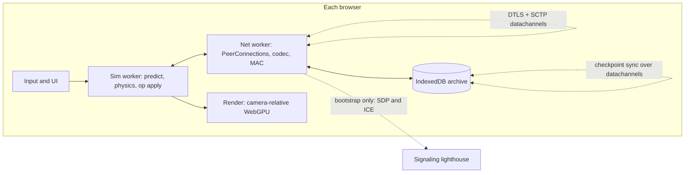

# MERIDIAN
## Implementation specification
**Data plane: WebRTC only.** Game bytes move on `RTCDataChannel`s between browsers. Nothing that decides a hit, a dig, a claim, or a death is allowed to terminate on a server.

This spec turns the concept into buildable contracts. It does not restyle the fantasy. Where the concept was silent, this document chooses.

Normative words: **MUST** / **MUST NOT** / **SHOULD** / **MAY**.

The design this implements is [concept.md](concept.md).

---

## 1. What ships first

The first playable cut is not a globe and not a monarch. It is this, in order, and nothing later starts before the current exit test is green:

| Phase | Exit test |
|---|---|
| **P0 Link** | Two browsers exchange an unreliable position and a reliable chat line. Killing packets does not stall chat behind movement, or movement behind chat. |
| **P1 Predict** | Eight peers, one cell. At 80 ms RTT the local body is immediate; remotes interpolate. A tab never holds more than 24 peer connections. |
| **P2 Witnessed hits** | A client that reports every shot as a hit is rejected unless two witnesses agree. |
| **P3 Op log** | A late joiner rebuilds a dug trench from a checkpoint plus ops and computes the same chunk hash. |
| **P4 Handover** | Walking across a cell boundary yields one body, no pop, no double inventory. |
| **P5 Strike scope** | A strike peer’s process has no bytes of another player’s wilderness inventory. |
| **P6 Aggregates** | A commander outside the cell renders company tokens from 2 Hz aggregates, not from 30 Hz soldier snaps. |
| **P7 Archive** | The signaling socket can be killed after the mesh exists and the session continues. A second peer refuses a solo log that rewrites a signed checkpoint. |
| **P8 Crust** | Radial down, a moving dayline, and a seam-free walk across a cube-sphere face. Same net stack. |
| **P9 Dominion** | Roads, fabbers, tithes, and deeds are new op types on the same log. No second protocol. |

P0–P4 are the network. If they are wrong, the rest does not matter.

---

## 2. System shape



Three processes of logic, one origin:

- **Sim** owns predicted state and applies certified ops.
- **Net** owns sockets, crypto sessions, and bytes. It does not decide gameplay.
- **Render** is a view. It never writes the hashed world.

`RTCPeerConnection` **SHOULD** live in a dedicated worker. If the browser refuses, it **MAY** run on the main thread, with encode/decode still off the submit path. The origin **MUST** send `Cross-Origin-Opener-Policy: same-origin` and `Cross-Origin-Embedder-Policy: require-corp` so the sim and the renderer can share buffers. Without those headers, fall back to copying, do not fake shared memory.

A **lighthouse** is a tiny presence service. It stores a pubkey, a cell id, a 15-second expiry, and opaque signaling blobs. It **MUST NOT** be sent snaps, ops, inventories, or votes. After two peers are connected, further introductions **SHOULD** be relayed on an existing datachannel so the lighthouse can die.

---

## 3. Modules

```text
src/net/signaling.ts     bootstrap client, not a transport for play
src/net/peer.ts          RTCPeerConnection lifecycle, ICE restart
src/net/channels.ts      negotiated datachannels
src/net/router.ts        degree cap, relay, subscriptions
src/net/session.ts       fingerprint pin, X25519, MAC, signatures
src/net/codec.ts         little-endian frames, ≤ 1100 bytes
src/sim/tick.ts          30 Hz sim, 2 Hz economy
src/sim/predict.ts       local pawn, input ring
src/sim/rewind.ts        witness traces
src/sim/quorum.ts        epoch, leader, votes
src/sim/oplog.ts         proposals, commits, checkpoints, fork choice
src/sim/cell.ts          hex index, handover
src/sim/interest.ts      who receives which Hz
src/world/ecef.ts        f64 planet frame, cell anchors
src/store/idb.ts         keys, checkpoints, pinned logs
src/render/                consumes interpolated state only
```

Hot path dependencies are the browser, WebCrypto, and a WASM physics step. No PeerJS-style helper that hides channel options. The options are the protocol.

---

## 4. Identity, space, time

**Identity.** On first launch, generate an Ed25519 key with WebCrypto and store the `CryptoKey` in IndexedDB (private key not left sitting in a JS string). The peer id is the 32-byte public key. The **short id** is its first 8 bytes; the cell refuses a join on collision. All archived ops are signed with this key. A new key is a new person. There is no account recovery except the user’s own key backup, which the client **MAY** offer as an encrypted file the user keeps.

**World frame.** Sim positions are **ECEF meters, float64**, origin at the center of Cairn. Radius is a named constant, default `320_000`. Wire format never carries raw f64. Each cell has an **anchor** (float64 ECEF) published in its checkpoint. Keyframes are **int32 centimeters relative to that anchor**. Deltas are **int16 centimeters relative to the last keyframe**; overflow forces a new keyframe.

**Indexing.** Cells are a hierarchical hex grid on the unit sphere (H3’s index math is acceptable), used only for neighbor and routing. Center spacing at the play resolution is **~5 km**. Parent cells exist for the command zoom. H3 area functions are not sim truth. Crossing a face or a pentagon uses the same handover as any edge.

**Ticks.** Sim tick is **30 Hz**, fixed, from a cell epoch. Economy and aggregates are **2 Hz**. A uint32 tick wraps in about four years; checkpoints store the epoch so wrap is not ambiguity. Local frame time interpolates. It does not advance the hashed world.

**Clock.** On `ctrl`, four timestamps (send, receive, reply send, reply receive) estimate offset and RTT. Keep an EMA. Shot messages name a **cell tick**, not a wall clock. Witnesses rewind to that tick. Rewind farther than **200 ms** of estimated one-way delay **MUST** miss.

---

## 5. WebRTC, normative

### 5.1 What “primary” means

| Traffic | Path |
|---|---|
| Movement, shots, votes, ops, checkpoints, voice-later, peer introductions | `RTCDataChannel` over DTLS over ICE |
| SDP offers, answers, ICE candidates before any channel exists | Lighthouse, or a copy-paste code in dev |
| HTTP fetches of static client, world seed, public stun list | Ordinary HTTPS. Seed is content, not state |

**MUST NOT** send gameplay on WebSocket, HTTP, or WebTransport in v1. **MUST NOT** open an SFU that terminates DTLS. A relay, if used, is another browser (or a dumb lighthouse in TURN mode) forwarding **already authenticated** packets. TURN sees ciphertext.

Media tracks are out of P0–P9 except a later proximity-voice add. Data-only peer connections: no transceivers.

### 5.2 Why these channel settings

WebRTC’s data plane is SCTP (RFC 8831). Defaults are reliable and ordered, which will stall a firefight behind a checkpoint. Different channels are different SCTP streams, so loss on one does not reorder another. They still share one congestion window: a flood of reliable bytes **will** delay snaps. The app, not the browser, has to be polite.

SCTP may fragment a large message and, unless I-DATA interleaving (RFC 8260) is actually negotiated by that browser, a fat reliable message blocks other sends on the association. **Do not depend on interleaving.** Every hot message **MUST** fit in **1100 bytes** so it is one SCTP user message and one UDP packet. Bigger objects are chunked by us.

`priority` on `RTCDataChannel` is not portable. **MUST NOT** rely on it. Schedule in the net worker: drain `ctrl` heartbeats, then a small quota of `ops`, then the newest snap only.

### 5.3 The channel table

Both peers call `createDataChannel` with `negotiated: true` and the same id **before** `createOffer` / `createAnswer`. No `ondatachannel`, no renegotiation to add the core set. `binaryType = "arraybuffer"`.

`maxRetransmits` and `maxPacketLifeTime` are mutually exclusive. Leave both unset for reliable.

| id | Label | ordered | retransmits | Use |
|---|---|---|---|---|
| 0 | `ctrl` | true | reliable | Handshake, clock, heartbeats, interest, signaling relay, membership |
| 1 | `ops` | true | reliable | Proposals, commits, votes, chunked checkpoints |
| 2 | `snap` | false | 0 | Newest pose only. Lossy |
| 3 | `input` | false | 0 | Redundant input rings toward witnesses |
| 4 | `relay` | false | 0 | Encapsulated snaps/inputs for a peer we do not hold directly. Reliable user data **MUST NOT** be carried here |

Ids 5–15 are reserved. An app that opens a mystery channel is out of spec.

**Backpressure.** Read `bufferedAmount` before every send.

- `snap`: if `bufferedAmount` is above **64 KB**, drop the snap. Never queue a fresher pose behind an older one.
- `input`: same, but always try to include the newest tick in the next packet that does send.
- `ops` / `ctrl`: if `bufferedAmount` stays above **256 KB** for **2 s**, mark the peer unhealthy and ICE-restart once. If it is still stuck, close. Do not grow a minute of unsent trench-digs.
- Set `bufferedAmountLowThreshold` and resume on the low event. Do not busy-poll.

### 5.4 Connection lifecycle

1. Load the long-term key. Sign a presence record `{pubkey, cell, protocols: [1], now}`.
2. Lighthouse returns up to **32** peers in that cell and the **6** neighbors, preferring quorum members if it has been told any (it only stores who claimed the role; the claim is not trusted).
3. Offer to peers until the degree target is met: all quorum members you can find, then nearest short-ids, then stop.
4. `iceServers`: a public STUN list plus an optional TURN URL on the lighthouse. `iceTransportPolicy` stays `all`. A dev switch **MAY** force `relay` to test TURN.
5. Trickle ICE. The lighthouse forwards candidates opaquely and forgets them.
6. On DTLS connect, read the remote fingerprint from the SDP/stats. The first `ctrl` message **MUST** be `Bind {pubkey, sig(fingerprint)}`. Drop the peer if the signature fails or the pubkey was not the one you dialed.
7. Run an X25519 handshake on `ctrl`. HKDF-SHA256 the shared secret with both pubkeys and both fingerprints into a send key and a receive key. Snaps and inputs after this use a **16-byte BLAKE3 MAC**. Ops, votes, and checkpoints keep a full **Ed25519** signature so an archive can check them with no session key.
8. Send `Hello` with protocol version, cell, tick estimate, capabilities (`archive`, `quorum-willing`).

**Glare.** If both sides offer, keep the connection whose offerer has the greater short id and close the other once both are up. In-flight reliable messages are not migrated; replay them.

**Degree cap.** A client **MUST NOT** hold more than **24** `RTCPeerConnection`s. A cell **SHOULD** be designed so a fight fits in **16** endpoints. Above that, extra bodies are remote via relay or shown as aggregates.

**ICE restart** on `disconnected` after **3 s**. Full recreate after **10 s**. The entity id does not change, because it is the pubkey.

**Closing.** Send `Bye` on `ctrl` if the channel is open, then `pc.close()`. On page hide, try `Bye` with a short timeout; the cell must tolerate a vanished peer anyway.

### 5.5 Bootstrap signaling

This is the only non-WebRTC protocol, and it is not part of play.

Lighthouse messages, JSON, because they are rare:

```text
announce  { pubkey, cell, sig }
list      { cell } -> [{ pubkey, cell, exp }]
signal    { to, from, blob }   // SDP or ICE, opaque, ≤ 64 KB
intro     not on the lighthouse; see below
```

Presence TTL **15 s**, refresh **5 s**. The lighthouse **SHOULD** rate-limit `signal` per pubkey. It **MUST NOT** inspect `blob` except to cap size.

Once any datachannel is open, a peer **MAY** ask a neighbor to pass a `signal` blob to a third pubkey (`Intro`). That neighbor forwards it if it has the link, or returns `IntroFail`. This is how a mesh grows and how a joiner reaches a cell the lighthouse has never seen, as long as one archive or neighbor is already up.

Dev mode **MAY** replace the lighthouse with a pasted offer code. The byte protocol does not change.

### 5.6 Frames

Little-endian. Version **1**. Anything else is dropped.

Clear header, never encrypted, so a relay can route without being in the session:

```text
0   u8   version
1   u8   flags          bit0 = relay, bit1 = keyframe, bit2 = encrypted
2   u16  type
4   u32  cell_tick
8   u64  src_short
16  u64  dst_short      0 = the peer on this connection
24  u8   ttl            0 on a direct packet; relay starts at 3
25  u16  payload_len
27  …    payload        if encrypted: nonce (24) || ciphertext || tag (16)
```

Direct snap/input payload layout after decrypt, keyframe:

```text
u64  entity
i32  x_cm
i32  y_cm
i32  z_cm
u16  yaw
i16  pitch
i16  vx, vy, vz          cm/tick, clamped
u16  state_bits          stance, grounded, strike-scoped, downed
u16  anim
u32  keyframe_id
```

Delta replaces the three `i32`s with three `i16`s and sets the keyframe flag off. If the encoder would overflow int16, it emits a keyframe instead.

Input packet, unreliable, **redundant**:

```text
u8   count               1..8
repeated:
  u32 tick
  i16 move_x, move_y
  u16 yaw, buttons
  u8  weapon_slot, utility_slot
```

The oldest tick in the ring **MUST** still be within the rewind window or it is useless; do not send eight ticks of ancient input.

Shots are **not** inputs. A shot is a signed proposal (below). Putting hit claims on the lossy channel is how cheaters get a free vote.

**Ops fragmentation.** Checkpoint and catch-up blobs split into records of at most **960** bytes of content so the frame stays under 1100 with signature:

```text
u64  object_id
u32  index
u32  count
u32  total_len
u8   bytes[]
```

Receiver hashes the reassembly. A missing piece triggers `Resend {object_id, index}` on `ops`. Give up after **5 s** and ask for a newer checkpoint.

### 5.7 Relay

If there is no direct connection and the message is ephemeral (`snap`, `input`):

- Wrap the already-authenticated inner frame.
- Set `flag relay`, `dst_short` to the final peer, `ttl = 3`.
- Send on channel `relay` to a peer listed as a route toward that cell.

Relays decrement `ttl`, refuse what they cannot route, and **MUST NOT** rewrite the inner MAC. They **SHOULD** prefer not to relay (tell the sender to open a direct link) when both parties are under the degree cap. Relays **MUST NOT** carry `ops`. Signed ops go direct to at least two quorum members; if you cannot open those links, you cannot commit, and the UI says so.

### 5.8 Bandwidth

Budget for a peer that can see 24 other players, unicast, no heroics:

| Band | Hz | Payload target | Notes |
|---|---|---|---|
| 0–40 m | 30 | ≤ 48 B delta | The duel |
| 40–200 m | 15 | ≤ 48 B | Same cell fight |
| 200 m–2 km | 5 | keyframe every 1 s | Vehicles, artillery |
| Strategic subscribe | 2 | aggregate ≤ 400 B | Not per body |

Worst case one peer, 8 near + 16 far: on the order of **15–25 KB/s** outbound before MACs and SCTP. Full mesh of 16 near peers is the failure mode the degree cap and the distance Hz exist to prevent. The net worker **MUST** expose sent bytes, dropped snaps, and `bufferedAmount` in a debug overlay. If outbound exceeds **80 KB/s** for 5 s, drop the farthest subscriptions first.

---

## 6. Who is allowed to be right

### 6.1 Two kinds of truth

**Ephemeral.** Poses, animations, particles, debris orientation. Newest packet wins. Divergence is a visual bug, not a fork.

**Hashed.** Terrain, structures, inventories, claims, allegiance, strike score, committed damage, corpses. These live only in the op log. A pose packet that says you are dead is ignored. A certified `DamageCommit` is not.

Debris and ragdolls are spawned from a commit (“this wall failed”) and then simulated locally. They are not hashed. Two clients may disagree about a brick’s rest pose. They **MUST** agree the wall is gone.

### 6.2 Quorum

Every occupied cell has a quorum set for the current **epoch (30 s)**:

- Sort peers who have been present **≥ 10 s** and who set `quorum-willing` by `hash(epoch || cell || pubkey)`.
- Take the first **3**. If fewer than 3 exist, the set is whoever is there, and the cell is **degraded**.
- **Leader** is the lowest short id in the set. No election messages. Leadership changes when the epoch changes or when the leader misses heartbeats for **1 s** (quorum members heartbeat at 5 Hz on `ctrl`, ~20-byte packets).
- Degraded rules: **1 peer** may commit, tagged `solo`. **2 peers** need both signatures. **3** need **2 of 3**. A later full quorum **MUST** refuse a `solo` suffix that contradicts a checkpoint it already holds.

A client in the first 10 seconds may play and predict. Their proposals wait, or a degraded quorum commits them. They do not vote.

### 6.3 Proposals

Clients do not write the log. They propose. The leader sequences.

```text
Proposal
  proposer, cell, client_nonce
  body                         // one of the op types in §7
  sig over those fields
```

Leader checks the rule for that body (reach, materials, strike jurisdiction, rate). On accept it broadcasts:

```text
Commit
  cell, seq, proposal_hash, tick
  leader_sig
```

Other quorum members re-check and emit `Vote {seq, accept, sig}`. A `Cert` is the commit plus enough votes. Apply when the cert is complete, in `seq` order. Holes: wait, then `Resend`. Do not apply seq+1 to skip a dig you never saw.

`seq` is per cell, starts at 1, never reused. A new leader continues at last certified seq + 1.

Rate limit proposals per pubkey: **8/s** burst **32**. Terrain proposals that touch more than **64** chunks are rejected and must be split.

### 6.4 Shots

```text
ShotProposal
  shooter, weapon, origin_cm[3], dir_i16[3], tick, nonce
  sig
```

Each witness:

1. Rejects if `tick` is outside the rewind window or the shooter could not have been at `origin` given their last certified movement (a slack of **0.5 m** plus one tick of acceleration).
2. Rewinds **hashed-relevant** targets (capsules, structure AABBs) to `tick` using stored snap history. This buffer is **16 ticks** minimum.
3. Runs the same trace the shooter ran: analytical ray or ballistic, penetration depths from the material table. The trace function **MUST** be pure and shared (same WASM on every client).
4. Votes `hit {entity or structure, part, distance}` or `miss`.

On a 2-of-3 match, the leader commits `DamageCommit`. Health changes only there. The shooter predicts blood and sound immediately and **rewinds the prediction** if the cert says miss. Do not wait for the cert to show the shot leaving the barrel.

Friendly fire and strike-versus-wilderness rules are fields on the commit, applied by the same function everywhere. They are not a local filter.

Melee is a short sphere sweep with the same vote. Building and digging do not use rewind; they use reach at certify time (**4 m** hands, more only if a tool’s spec says so) and the server-free equivalent: the quorum checks the proposer pose history.

### 6.5 Interest

A peer receives entity snaps only if at least one is true:

- inside **2 km**, or
- inside a shared strike, or
- visible to a sensor this peer is allowed to use (mast, vehicle, war table) with that sensor’s range.

The quorum enforces this by **not relaying and not answering** resubscribe for entities outside it. A client may still cheat its **own** view of data it was sent. The protocol’s job is to not send the rest. Sensor coverage is a hashed structure plus a pose, so witnesses agree who is entitled to a subscription.

`Subscribe {cell, level: duel|local|strategic}` is a `ctrl` message. Strategic subscriptions receive **aggregates only**:

```text
Aggregate
  cell, tick
  counts by stance
  centroid_cm[3]
  flux, metal_hint
  contested: bool
```

No pubkeys in aggregates below a count of **8** (no “the commander selected one dot and got a person”). A commander who wants a person walks into duel range or gets a witness report, which is itself a proposal another player sends.

### 6.6 Handover

When a predicted body crosses a boundary:

1. Owner sends `HandoverIntent {entity, from, to, pose}` to both quorums.
2. Destination reserves the entity id and answers `HandoverHold`.
3. Source commits `HandoverOut` including the inventory hash. Destination commits `HandoverIn` with the same hash. Apply is atomic: if `In` is not certified within **2 s**, source commits `HandoverAbort` and keeps the body.
4. Pose snaps switch anchor. The renderer interpolates in ECEF so the mesh does not pop even if the cell id does.

One entity, one cell. Duplicates are a bug of cert application: if both cells claim it, the higher cert tick wins and the other **MUST** emit `HandoverAbort`. Inventory hash mismatch aborts.

### 6.7 Late join and fork choice

Joiner connects, binds, then `CatchUp {cell, have_checkpoint}`. A quorum member sends the latest checkpoint (chunked on `ops`) and the op suffix. Joiner applies from the seed (empty chunks are pure functions of `world_seed || cell || chunk`) through the suffix, hashes the touched chunks, and **MUST** match. On mismatch, ask a second quorum member. If they disagree, use fork choice:

1. Prefer the chain that extends the highest checkpoint certified by a non-solo quorum.
2. Else the chain with more independent archive signatures on that checkpoint.
3. Else lower checkpoint hash, so the split is deterministic.

Then say so in the UI. Silent healing of a conflict is how duped metal happens.

---

## 7. Op bodies

The log is the game. New features are new bodies, not new transports. Each body is canonical CBOR (map keys sorted, no floats; integers and byte strings only) so hashes match across languages. The hot pose path stays binary; **only ops use CBOR**.

| Body | Commit checks |
|---|---|
| `TerrainEdit {chunks, before_hash, after_ops}` | Reach, tool, `before_hash` still current. Ops are add/remove of quantized SDF samples, not “set the mesh to this blob.” |
| `Place {blueprint, site, materials}` | Deed rights, logistics link or carried materials, support graph accepts the load. |
| `DamageCommit {shot_hash, target, delta}` | Only the leader synthesizes this, and only from a vote majority. Clients **MUST NOT** propose it directly. |
| `Transfer {from, to, stack, qty}` | Both inventories in this cell or in a certified handover. No negative stacks. |
| `Craft {recipe, quality_inputs}` | Station, skill hash, fuel. Quality is an integer formula in the shared recipe table. |
| `Deed {volume, upkeep}` | Volume free or owned, upkeep prepaid. |
| `Upkeep` | Tick of the economy clock. Lapse drops the deed to unclaimed but **does not** delete structures. They become salvage. |
| `HearthBind` | One active hearth per pubkey. The stone is a `Place` that already exists. |
| `Allegiance {swear or break, patron}` | One patron. Surplus mastery and tithe percents are integers. Break is unilateral. |
| `StrikeOpen {site, rules, stake}` | Site volume, both sides’ bonds. Rules are an enum: loadout-only, friendly-fire off, timer. |
| `StrikeJoin / StrikeResolve` | Resolve pays scrip and bonded-item outcomes. Scrip ids are scoped to `strike_id` and **MUST NOT** appear in wilderness inventory structs. |
| `LogisticsLink {a, b, kind}` | A physical road, pipe, or cable already placed along the polyline. Streaming industry is legal only inside a connected component of these links. |
| `FactoryQueue` | Power and metal at the site, graph connected. |
| `HandoverOut / In / Abort` | As §6.6. |

Wilderness death is `DamageCommit` to zero plus `Transfer` of carried stacks onto a new corpse entity. Strike death does not transfer wilderness stacks, because those stacks are not in the strike scope.

---

## 8. Sim contracts the net expects

These are requirements the protocol cannot patch around.

**Determinism where it counts.** Chunk apply, recipe math, ballistics, and penetration **MUST** be pure functions of their inputs: fixed-step, no `Date`, no `Math.random` without a seeded counter in the proposal. Physics of debris **MAY** differ. Do not put debris in the hash.

**Prediction.** The local pawn simulates on keydown. Remotes are interpolated **100 ms** behind the newest snap, jitter buffer grown if RTT variance says so, capped at **250 ms**. Past the cap, snap. Input ring from §5.6 is what witnesses replay; the predicted pawn and the witness **MUST** share that reconstruction for movement. If they drift by more than **0.5 m**, the next cert of a shot will miss and the client corrects the pawn to the witness pose. Hard-correct the camera gently (a short ease), do not rubber-band every tick.

**Weapons.** Hitscan is the limit case of a ray inside a per-weapon range. Beyond it, the same code path integrates a projectile with radial gravity and a wind sample. Wind samples come from the cell’s climate record, which is a seeded field plus certified storm ops, not a client-side particle.

**Structures.** The hashed object is the support graph and the SDF samples. The rendered mesh is derived. Collapse commits a `TerrainEdit` plus debris spawn ids. It does not stream triangles.

**Gravity.** Acceleration is `-g * normalize(ecef)` with `g = 9.81`. Vehicles, shells, and water probes use it. The character controller is a capsule on that up-vector, kinematic enough to stop and peek, dynamic enough to be shoved by a committed impulse.

**Dayline.** Flux at a site is a function of the sun direction and the horizon mask of the SDF. Sun direction is `tick → rotation`, shared. No replication of “is it night” as a boolean a client can flip.

**Strike isolation.** Entering a strike swaps the active inventory pointer. Snapshots in strike scope use a different entity sub-id. The wilderness inventory object **MUST NOT** be serialized into any packet, aggregate, or checkpoint chunk that a non-owner in that strike receives. Owner’s own client keeps it in memory, local only, until they leave.

**Archives.** Any client **MAY** set `archive`. It pins checkpoints and certs for cells it cares about (allegiance deeds, neighboring cells) in IndexedDB, and answers `CatchUp`. IndexedDB quota failure means you are not an archive; tell the user. The world seed is static and **MAY** be hosted as a file. The op suffix is the world.

---

## 9. Loop

```text
net worker, whenever:
  decrypt, verify, push snaps into a latest-only slot
  push certs into an ordered inbox

sim, every 1/30 s:
  sample input, step prediction, step local physics
  apply any cert whose seq is next
  build the snap you will offer the net worker
  if a shot button edge: submit ShotProposal

net, every frame but not more than the Hz table:
  if snap slot for peer P is due and bufferedAmount allows: send
  pump ops, respecting backpressure
  drop, don’t queue, stale snaps

render, every frame:
  interpolate ECEF from the sim’s published buffer
  camera-relative positions in float32 for the GPU
  never read the socket
```

The GPU path is hybrid, as in the concept: raster primary, ray-traced shadows and reflections against a BLAS rebuilt when a chunk hash changes. That rebuild is allowed to be a frame late. The hash is not.

---

## 10. Threats the protocol actually answers

| Attack | Response |
|---|---|
| Forged hit | Quorum trace, not the shooter’s word |
| Teleport pose | Witnesses reject shot origins far from history; movement itself is ephemeral but commits use history |
| Rewriting a deed you left | Fork choice against the signed checkpoint |
| Lighthouse reads the fight | Lighthouse never gets the bytes |
| Lighthouse impersonates a peer | Fingerprint bound into `Bind` and the session key |
| Relay edits a snap | End-to-end MAC |
| Wallhack via full-cell broadcast | Interest filter at the sender, aggregates instead of bodies |
| Solo miner invents a mountain, then a witness arrives | Witness replays; mismatch falls to fork choice. Solo tag is visible |
| Sybil quorum | 10 s presence before a vote, and a cell’s voters are a hash lottery, not “whoever opens 3 tabs” unless those tabs really sit there. Three tabs of one human still degrade a **deserted** cell. Do not pretend otherwise. Abandoned cells are cheap to vandalize; inhabited ones are not |
| Replay of an old cert | `seq` and epoch in the signed bytes; archives store the high-water seq |
| Checkpoint DoS | Chunk size cap, rate limit, drop peer |
| NAT blackhole | STUN, then TURN as a dumb relay, then “you have no path,” which is an honest UI |

Out of scope, said plainly: a cheated client still aims perfectly with the data it was allowed to receive. A fully deserted cell is as strong as its archives. A user who loses their key is a new person.

---

## 11. Tests

Automate these before P2 is called done. They are the spec in executable form.

1. **Channel isolation.** Block the process that sends on `snap` (drop every packet). `ops` still delivers a 1 KB commit in under 500 ms on a quiet link.
2. **Loss.** 10% drop, 80 ms ± 30 ms. Local pawn stays responsive. Remotes stay continuous or snap; they never freeze the tab waiting for a seq on the snap channel.
3. **Backpressure.** Inflate `bufferedAmount` on `snap` and assert older snaps are discarded (monotonic keyframe ids at the receiver).
4. **Liar.** One peer’s shot callback always returns hit. With two honest witnesses the cert is a miss.
5. **Hash.** Two browsers apply the same 100 `TerrainEdit`s from a checkpoint and compare chunk hashes.
6. **Catch-up.** Third peer joins after those edits, no prior state, and matches.
7. **Fork.** Two solo logs diverge. A third peer with the older quorum checkpoint keeps the checkpoint’s child and rejects the other.
8. **Handover.** Script a walk across a border under 100 ms RTT and 5% loss. Inventory hash constant, one entity id.
9. **Degree.** Spin up 40 signal presences. The client opens ≤ 24 connections.
10. **Lighthouse dies.** Disconnect signaling after P0 handshake. Movement and a commit still flow.
11. **Scope.** During a strike, dump serialized outbound packets. Wilderness item ids do not appear.
12. **MTU.** Assert the encoder refuses a single frame over 1100 bytes.

Run the multi-peer cases in one machine with several `RTCPeerConnection`s and, separately, on two real browsers. Loopback alone will not show ICE or MTU.

---

## 12. Defaults

| Constant | Value |
|---|---|
| Planet radius | 320 km |
| g | 9.81 m/s² toward −ECEF |
| Cell spacing | ~5 km |
| Sim / snap cap / economy | 30 Hz / distance table / 2 Hz |
| Epoch | 30 s |
| Quorum | 2 of 3, or degraded |
| Rewind cap | 200 ms |
| Interpolation delay | 100 ms, max 250 ms |
| Pose error before correct | 0.5 m |
| Degree cap | 24 |
| Frame cap | 1100 B |
| Snap buffer high water | 64 KB |
| Ops buffer fail | 256 KB for 2 s |
| Presence before vote | 10 s |
| Heartbeat | 5 Hz, timeout 1 s |
| Relay TTL | 3 |
| Protocol version | 1 |

Change them with a version bump, not with a quiet fork. Two clients with different versions **MUST** refuse the `Hello`.

---

## 13. What this spec refuses to pretend

- WebRTC still needs a first introduction. That introduction is not the game server, and the exit test in P7 exists so it stays that way.
- SCTP is not UDP. Unreliable unordered with `maxRetransmits: 0` is as close as the browser allows, and shared congestion is real. Small messages and a drop-newest snap policy are the workaround.
- Three browsers are not a global authority. They are a local one, and the log is how the next three agree.
- P0 is a successful project even if the globe is still a flat test cell, as long as the channels, the cert, and the hash behave. The sphere is P8. The war is the log.
